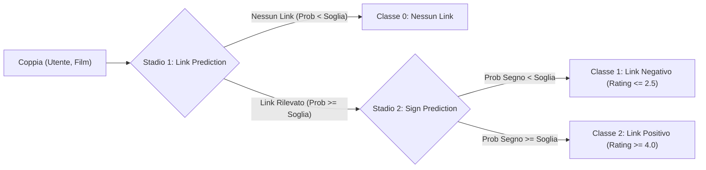

# Signed Bipartite Network: Link & Sign Prediction

[](https://www.python.org/)
[](https://pytorch.org/)
[](https://pyg.org/)
[](https://scikit-learn.org/)
[](LICENSE)

Framework modulare end-to-end per la **Link Prediction** e la **Sign Prediction** su reti bipartite firmate, validato sul benchmark **MovieLens 10M** .

Il repository confronta due paradigmi metodologici completi:
1. **Approccio Tradizionale (Feature-Based)**: estrazione di feature topologiche, temporali e collaborative (bias di Koren, Signed SVD) con classificatori supervisionati (`HistGradientBoosting` / `LogisticRegression`).
2. **Approccio Deep Learning a Grafo (Multi-Task GNN)**: architettura neurale bipartita con message passing eterogeneo differenziato su archi positivi/negativi e teste di predizione congiunte.

---

## Indice

- [Struttura del Progetto](#struttura-del-progetto)
- [Pipeline Link & Sign Prediction](#architettura-a-due-stadi-two-stage-pipeline)
- [Sintesi dei Risultati Sperimentali](#sintesi-dei-risultati-sperimentali)
- [Installazione e Setup](#installazione-e-setup)
- [Endpoint e Comandi di Esecuzione](#-endpoint-e-comandi-di-esecuzione)
  - [1. Endpoint CLI: Pipeline Tradizionale (`run_traditional.py`)](#1-endpoint-cli-pipeline-tradizionale-run_traditionalpy)
  - [2. Endpoint CLI: Pipeline GNN Multi-Task (`run_gnn.py`)](#2-endpoint-cli-pipeline-gnn-multi-task-run_gnnpy)
  - [3. Configurazione Globale (`config.py`)](#3-configurazione-globale-configpy)
- [Licenza](#licenza)

---
## Struttura del Progetto

```text
ProgettoSMN/
├── config.py                 # Configurazione centralizzata (percorsi, soglie, mapping)
├── run_traditional.py        # [CLI Endpoint] Pipeline Tradizionale a Due Stadi
├── run_gnn.py                # [CLI Endpoint] Pipeline GNN Multi-Task
│
├── traditional/              # Modulo per l'approccio Feature-Based
│   ├── dataset.py            # Ingestion dati MovieLens, split temporale e cache CSV
│   ├── model.py              # Definizione classificatori (GBM / Logistic Regression)
│   ├── trainer.py            # Routine di training e calcolo metriche
│   ├── pipeline.py           # Pipeline a cascata Two-Stage e inferenza
│   └── features/             # Estrazione feature topologiche, temporali e collaborative
│       ├── link_features.py  # 7 feature per Link Prediction
│       ├── sign_features.py  # 15 feature per Sign Prediction (Koren baseline, Signed SVD)
│       └── common.py         # Costanti e utility condivise
│
├── gnn/                      # Modulo per l'approccio Deep Learning a Grafo
│   ├── dataset.py            # Costruzione grafo eterogeneo bipartito e campionamento negativi
│   ├── model.py              # BipartiteGNNEncoder, EdgePairMLPHead, MultiTaskBipartiteGNN
│   ├── trainer.py            # Ciclo di addestramento Multi-Task con early stopping
│   └── pipeline.py           # Pipeline a due stadi basata su embedding GNN
│
├── results/                  # metriche e statistiche riproducibili
│   
│
└── data/
    ├── ml-10M100K/           # Dataset grezzo MovieLens 10M (ratings.dat, movies.dat)
    └── processed/            # Cache CSV, modelli (.joblib) e checkpoint GNN (.pt)
```
---

## Pipeline Link & Sign Prediction

In uno scenario reale, la maggior parte delle coppie $(u, m)$ non interagisce. Il framework adotta una **valutazione a cascata congiunta**:



- **Classe 0 - Nessun Link**: la coppia non interagirà.
- **Classe 1 - Link Negativo**: l'utente valuterà negativamente l'item ($\le 2.5$ stelle).
- **Classe 2 - Link Positivo**: l'utente apprezzerà l'item ($\ge 4.0$ stelle).

---

## Sintesi dei Risultati Sperimentali

Metriche ottenute su test set out-of-time con coppie reali ed esempi negativi campionati:

| Modello | Stadio 1: Link Prediction | Stadio 2: Sign Prediction | Cascata Globale (3 Classi) |
| :--- | :--- | :--- | :--- |
| **Tradizionale (GBM)** | Accuracy: **82.59%** \| Recall: **82.36%** | ROC-AUC: **0.8273** \| Precision: **88.67%** | Accuracy: **68.35%** \| Weighted F1: **0.6873** |
| **GNN Multi-Task** | ROC-AUC: **0.8576** \| PR-AUC: **0.8104** | ROC-AUC: **0.8496** \| Precision: **94.10%** | Accuracy: **69.56%** \| Weighted F1: **0.7130** |

---

## Installazione e Setup

### 1. Clonazione e Ambiente Virtuale
```bash
git clone https://github.com/roccopiovardaro/ProgettoSMN.git
cd ProgettoSMN

python3 -m venv .venv
source .venv/bin/activate  # Su Windows: .venv\Scripts\activate
```

### 2. Installazione Dipendenze
```bash
pip install --upgrade pip
pip install torch torchvision torchaudio
pip install torch_geometric
pip install scikit-learn pandas numpy scipy joblib
```

---

## 🚀 Endpoint e Comandi di Esecuzione

Il progetto fornisce endpoint da riga di comando (CLI) completi per la preparazione dei dati, l'addestramento, la validazione a cascata e l'inferenza dimostrativa.

---

### 1. Endpoint CLI: Pipeline Tradizionale (`run_traditional.py`)

Gestisce l'intero ciclo dell'approccio feature-based: preparazione dataset, feature engineering, addestramento dei modelli supervisionati, valutazione a cascata e test di inferenza.

#### Comandi Pronti all'Uso:

```bash
# Valutazione rapida istantanea con modelli pre-addestrati (consigliato per test veloce)
python run_traditional.py --skip-train

# Addestramento completo Stadio 1 & Stadio 2 con HistGradientBoosting (default)
python run_traditional.py

# Addestramento con Logistic Regression
python run_traditional.py --model-type lr

# Personalizzazione delle soglie decisionali (Link a 0.5, Segno a 0.4)
python run_traditional.py --link-threshold 0.5 --sign-threshold 0.4

# Rigenerazione forzata di tutti i file CSV e feature prima del training
python run_traditional.py --prepare-dataset
```

#### Parametri e Flag CLI:

| Parametro | Tipo | Default | Descrizione |
| :--- | :---: | :---: | :--- |
| `--skip-train` | `flag` | `False` | Carica i modelli già addestrati (`data/processed/*.joblib`) saltando il training. |
| `--model-type` | `str` | `gbm` | Algoritmo da usare: `gbm` (HistGradientBoosting) o `lr` (LogisticRegression). |
| `--link-threshold` | `float` | `0.5` | Soglia di probabilità per predire l'esistenza del link nello Stadio 1. |
| `--sign-threshold` | `float` | `0.4` | Soglia di probabilità per predire segno positivo nello Stadio 2. |
| `--prepare-dataset`| `flag` | `False` | Forza la rigenerazione di tutti i file CSV elaborati in `data/processed/csv/`. |
| `--seed` | `int` | `42` | Random seed per garantire la riproducibilità. |

---

### 2. Endpoint CLI: Pipeline GNN Multi-Task (`run_gnn.py`)

Costruisce il grafo bipartito firmato, esegue il training congiunto multi-task con early stopping e valuta la cascata neurale.

#### Comandi Pronti all'Uso:

```bash
# Valutazione rapida istantanea del checkpoint salvato (consigliato per test veloce)
python run_gnn.py --skip-train

# Training rapido su campione (1.000.000 archi, 15 epoche)
python run_gnn.py --sample-size 1000000 --epochs 15

# Training completo sull'intero dataset MovieLens 10M
python run_gnn.py --sample-size 0 --dim 64 --hidden-dim 64 --epochs 20

# Selezione esplicita del dispositivo di calcolo (Apple Silicon MPS, NVIDIA CUDA o CPU)
python run_gnn.py --device mps   # su macOS Apple Silicon
python run_gnn.py --device cuda  # su Linux/Windows con GPU NVIDIA
python run_gnn.py --device cpu   # fallback su CPU

# Esecuzione con split temporale rigido da CSV anziché edge holdout
python run_gnn.py --split-mode temporal --epochs 10
```

#### Parametri e Flag CLI:

| Parametro | Tipo | Default | Descrizione |
| :--- | :---: | :---: | :--- |
| `--skip-train` | `flag` | `False` | Carica il checkpoint `data/processed/gnn_multitask_model.pt` senza riaddestrare. |
| `--sample-size` | `int` | `1000000` | Numero di interazioni di training da campionare (`0` per usare l'intero dataset). |
| `--epochs` | `int` | `15` | Numero di epoche di addestramento. |
| `--dim` | `int` | `64` | Dimensione degli embedding latenti dei nodi ($z_u, z_m$). |
| `--hidden-dim` | `int` | `64` | Dimensione interna dei layer convoluzionali e delle teste MLP. |
| `--num-layers` | `int` | `2` | Numero di strati convoluzionali eterogenei (GraphSAGE). |
| `--lr` | `float` | `0.003` | Learning rate per l'ottimizzatore AdamW. |
| `--batch-size` | `int` | `16384` | Dimensione del batch delle coppie di archi durante il training. |
| `--lambda-sign` | `float` | `1.0` | Peso $\lambda$ della loss di segno nella funzione obiettivo congiunta. |
| `--split-mode` | `str` | `transductive` | Modalità di partizione: `transductive` (edge split) o `temporal` (da CSV). |
| `--link-threshold` | `float` | `calibrata` | Soglia personalizzata per il link (default: valore ottimale calibrato su val). |
| `--sign-threshold` | `float` | `calibrata` | Soglia personalizzata per il segno (default: valore ottimale calibrato su val). |
| `--device` | `str` | `auto` | Dispositivo di esecuzione (`mps`, `cuda`, `cpu`). |

---

### 3. Configurazione Globale (`config.py`)

Tutti i percorsi e le impostazioni del dataset sono gestiti centralmente in [config.py](config.py):
- `SAMPLE_SIZE`: limita la dimensione del dataset per sperimentazioni rapide (`None` per 10M).
- `SPLIT_RATIOS`: percentuali per lo split temporale (`train: 0.70`, `val: 0.15`, `test: 0.15`).
- `rating_to_sentiment()`: logica di cut-off del rating ($\le 2.5 \rightarrow$ negativa, $\ge 4.0 \rightarrow$ positiva).
- `DATA_PROCESSED`: cartella contenente i file CSV elaborati e i checkpoint addestrati.
- `RESULTS_DIR`: cartella di destinazione dei report JSON (`results/*.json`).

